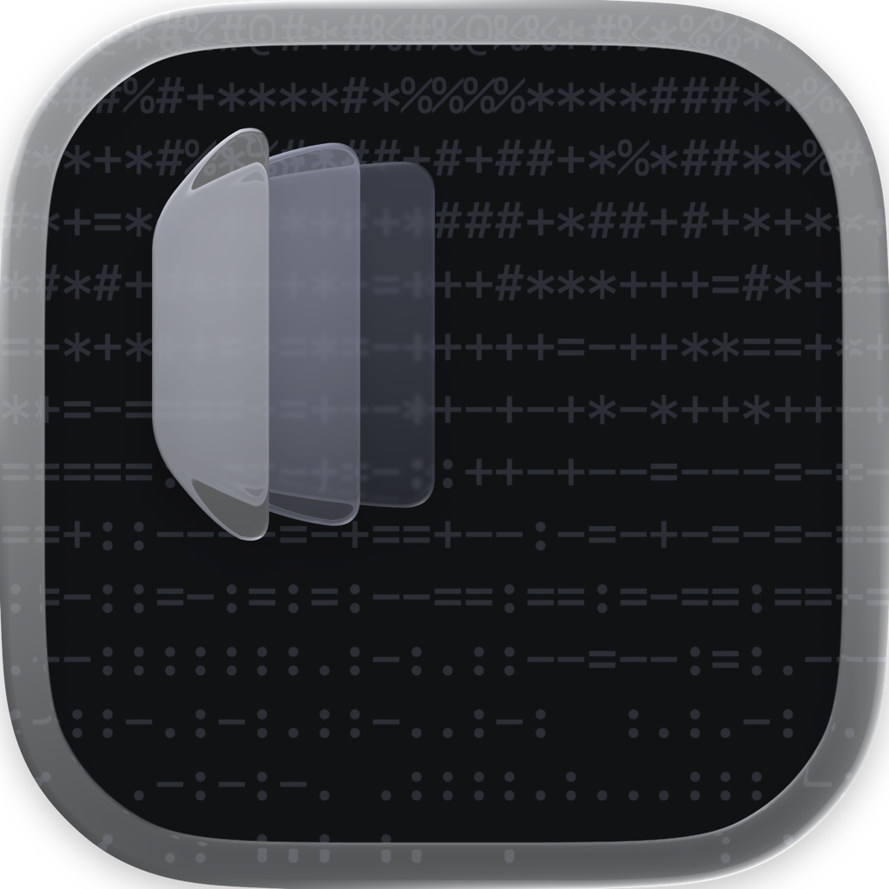
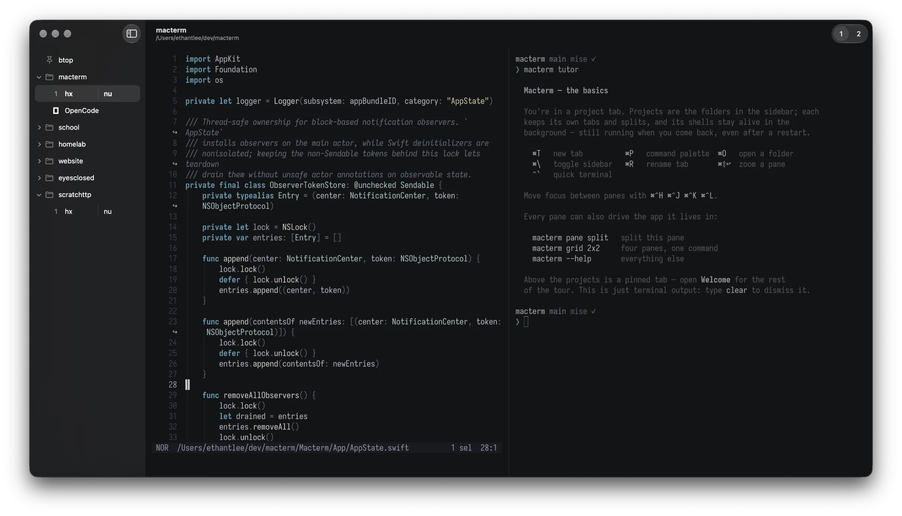

<h1 align="center">
  
  <br />
  Macterm
</h1>

<p align="center">
  A feature-rich macOS terminal built to be pleasant, native, and lightweight.
</p>

<p align="center">
  <a href="https://github.com/thdxg/macterm/releases/latest">
    
  </a>
  <a href="https://github.com/thdxg/macterm/releases">
    
  </a>
  <a href="https://github.com/thdxg/macterm/actions/workflows/checks.yml">
    
  </a>
  
</p>

<p align="center">
  <a href="https://macterm.thdxg.dev"><b>Website</b></a> ·
  <a href="https://macterm.thdxg.dev/docs"><b>Docs</b></a> ·
  <a href="https://github.com/thdxg/macterm/releases"><b>Releases</b></a>
</p>



<p align="center">
  <a href="https://macterm.thdxg.dev/#features"><b>Watch it work →</b></a>
</p>

> [!NOTE]
> This project has no relation to [MacTerm](https://github.com/kmgrant/macterm), an earlier macOS terminal emulator with the same name.

## Features

- **Session persistence**: your shells keep running when you quit, and every pane returns when you start Macterm again.
- **Vertical project sidebar**: projects and their tabs in a native macOS sidebar.
- **Splits and multiplexing**: split panes, drag a pane onto another, and move a pane to its own tab.
- **Remote projects**: open a folder on another machine over SSH. Its shells keep running on that machine.
- **Pinned tabs**: keep a tab above your projects. It starts with Macterm.
- **Command palette**: press <kbd>⌘P</kbd> for every command, with its keybind on the row.
- **Extensions**: add palettes for Git, Docker, Kubernetes, SSH and Claude Code, or write your own in YAML.
- **Save and restore layouts**: the tabs, splits and commands of a project in one YAML file.
- **Control CLI**: scripts and coding agents control Macterm with the `macterm` command.
- **Tab switcher**: hold the recent-tab keybind to pick a tab from live previews.
- **Copy mode**: move through the scrollback and select text with the keys of Vim or Helix.
- **Animations**: scrolling, splits and the cursor glide into place.
- **Quick terminal**: a drop-down terminal over any app, with a global keybind.
- **Desktop widgets**: a terminal on your desktop, in the grid and shape of the macOS widgets.
- **Password autofill**: Macterm saves the passwords that you type at a prompt and fills them in again.
- **Adaptive background**: the window takes the background color of the running program.
- **Ghostty compatibility**: your Ghostty config, theme, font and keybinds carry over.

## Install

### Homebrew

```bash
brew install --cask thdxg/tap/macterm
```

The cask removes the Gatekeeper quarantine attribute when it installs. The app then starts with no extra prompts.

### From Releases

Download the latest `.dmg` from [Releases](https://github.com/thdxg/macterm/releases). Open it and drag Macterm to Applications. The app has no Apple Developer certificate signature, so clear the quarantine flag one time:

```bash
xattr -cr /Applications/Macterm.app
```

After that, Sparkle installs updates. It checks an EdDSA signature on each update. You do not need `xattr` again.

## Configuration

Macterm reads your Ghostty config from the same places as Ghostty: `~/.config/ghostty/config` or `~/Library/Application Support/com.mitchellh.ghostty/config`. An existing setup carries over with no change. The [Ghostty option reference](https://ghostty.org/docs/config/reference) documents every key. A minimal config looks like this:

```ini
theme = catppuccin-mocha
font-family = JetBrains Mono
font-size = 14
```

A few Macterm defaults are different from the Ghostty defaults: theme, font size, padding and `macos-option-as-alt`. Macterm also sets `tab-inherit-working-directory = false`, so new tabs open at the project root. Macterm loads these defaults before your config. A key that you set always wins. `defaultsBody` in [`MactermConfig.swift`](https://github.com/thdxg/macterm/blob/main/Macterm/Config/MactermConfig.swift) has the full list.

Macterm has its own settings for window opacity, sidebar behavior, quick terminal size and keymaps. Open them with **Macterm → Settings**. The [configuration docs](https://macterm.thdxg.dev/docs/configuration) give the full order of precedence and the few window keys that Macterm overrides.

## Extensions

An extension streamlines your workflows for Git, Docker, Kubernetes, SSH, coding agents and more. Currently, it adds screens to the command palette ([example](extensions/git/README.md)). More capabilities are planned on the roadmap.

**To install:** open **Settings → Extensions**, find the extension and click **Install**. Its palettes appear at once in the **Palettes** section of the command palette (<kbd>⌘P</kbd>).

**To create your own:** make a folder in `~/.config/macterm/extensions/` with an `extension.yaml` file and a `palettes/` folder of YAML files. See the [extension docs](https://macterm.thdxg.dev/docs/extensions) for more detail.

**To contribute:** Open a PR to add your extension folder to [`extensions/`](extensions/).

## Cookbook

The community shares workflows and recipes: layouts, keybinds and scripts that people run with Macterm. For example:
- [Use one set of <kbd>⌃hjkl</kbd> keybinds to move between Neovim splits and Macterm panes](https://github.com/thdxg/macterm/discussions/217)
- [Drive an interactive program from a script](https://github.com/thdxg/macterm/discussions/218)
- [Give a coding agent control of Macterm](https://github.com/thdxg/macterm/discussions/219)
- [A Neovim plugin that moves focus between Neovim splits and Macterm panes with the same directional keybinds](https://github.com/thdxg/macterm/discussions/459)

Do you have a recipe? [Start a Cookbook topic](https://github.com/thdxg/macterm/discussions/new?category=cookbook). Anyone can post a recipe, and anyone can use one.

## Contributing

Read [CONTRIBUTING.md](CONTRIBUTING.md) for setup, build and pull request rules.

## License

MIT
