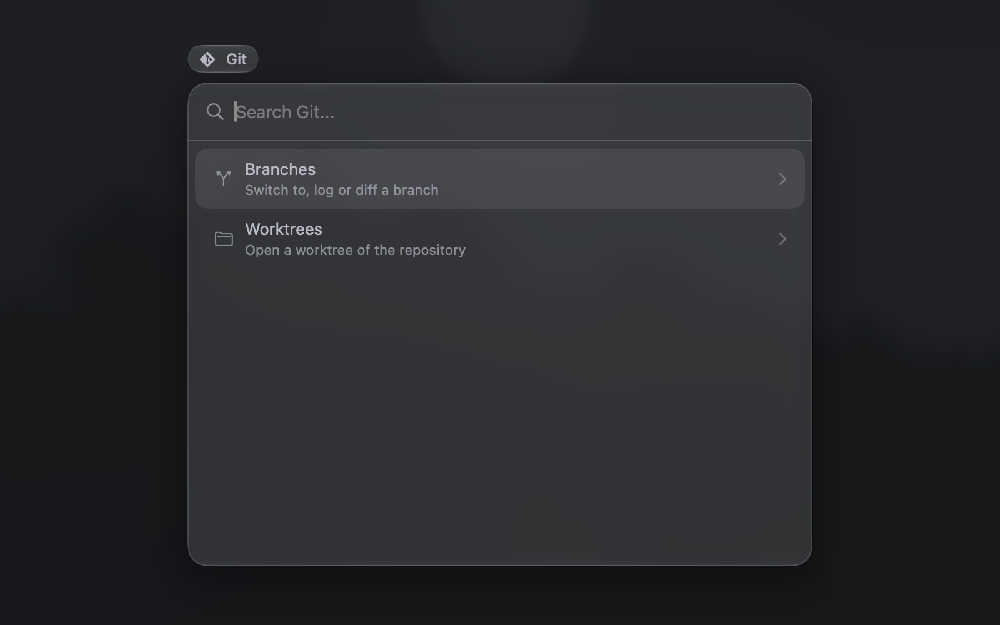
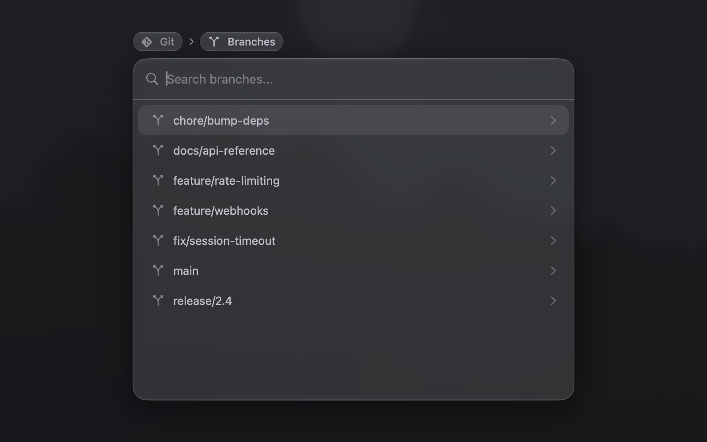
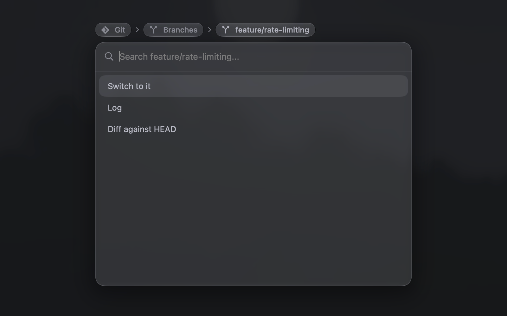
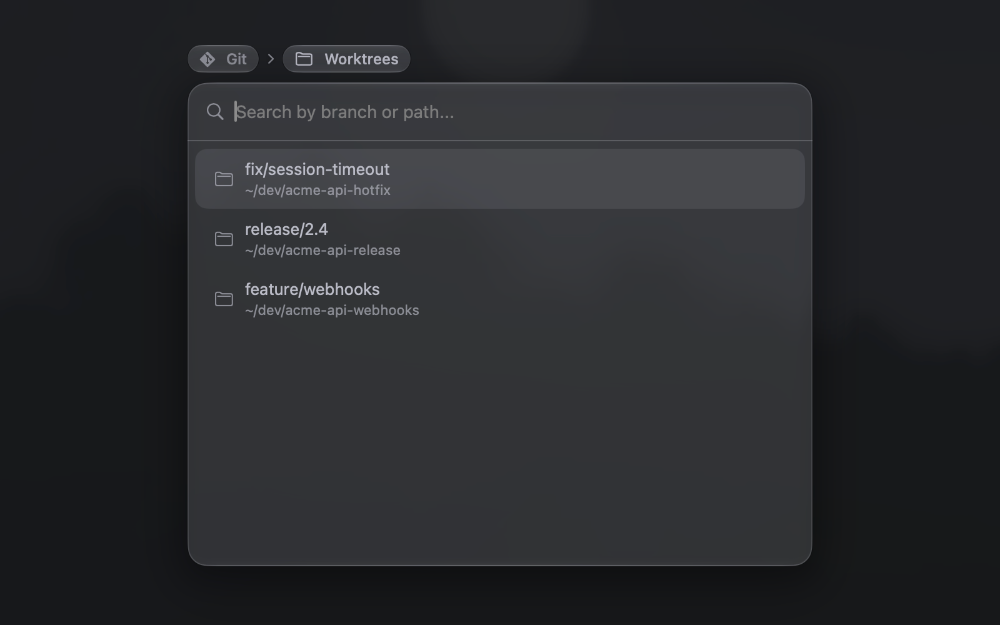

# Git

Browse the branches and the worktrees of the project.

- **Branches**: Switch to a branch, or show its log or its diff against HEAD, in a split.
- **Worktrees**: Open a new tab in another worktree of the repository. Each row shows the branch over the path. ⌥↩ opens the worktree in a split. The list does not show the worktree that the project is in, or a worktree whose directory is gone.

The palette is muted outside a git repository.

Needs `git`.

## Screenshots

### Git

### Branches

### Branch

### Worktrees

