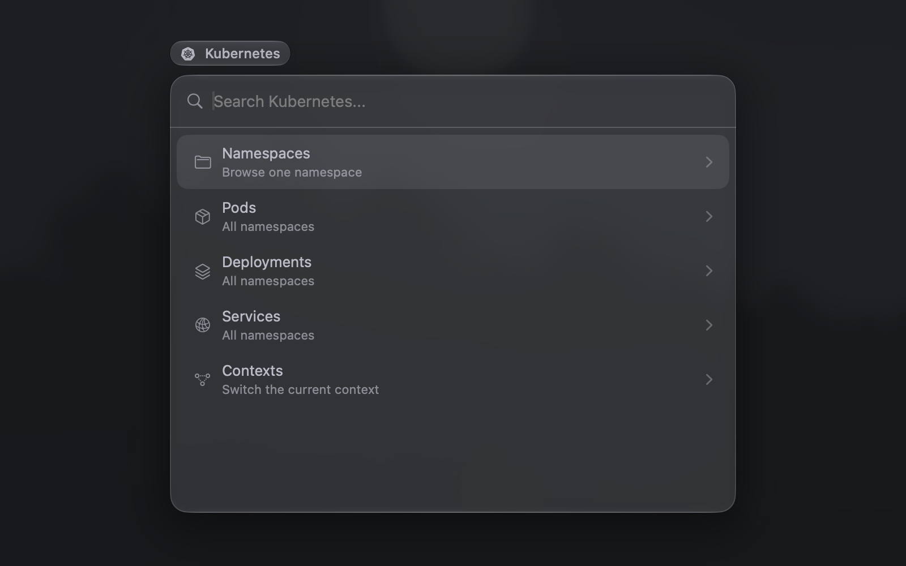
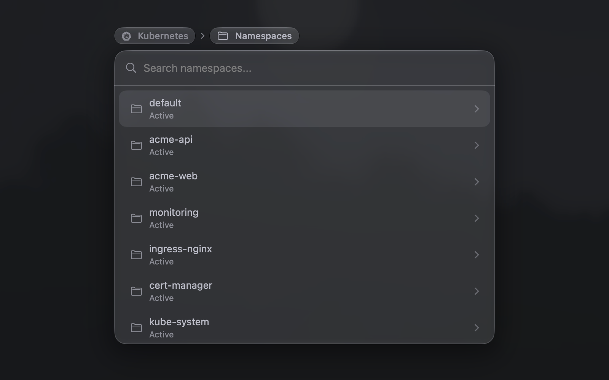
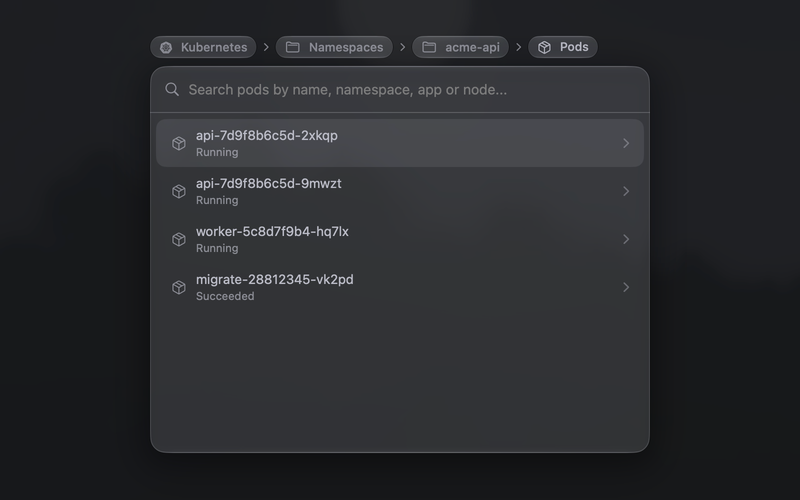
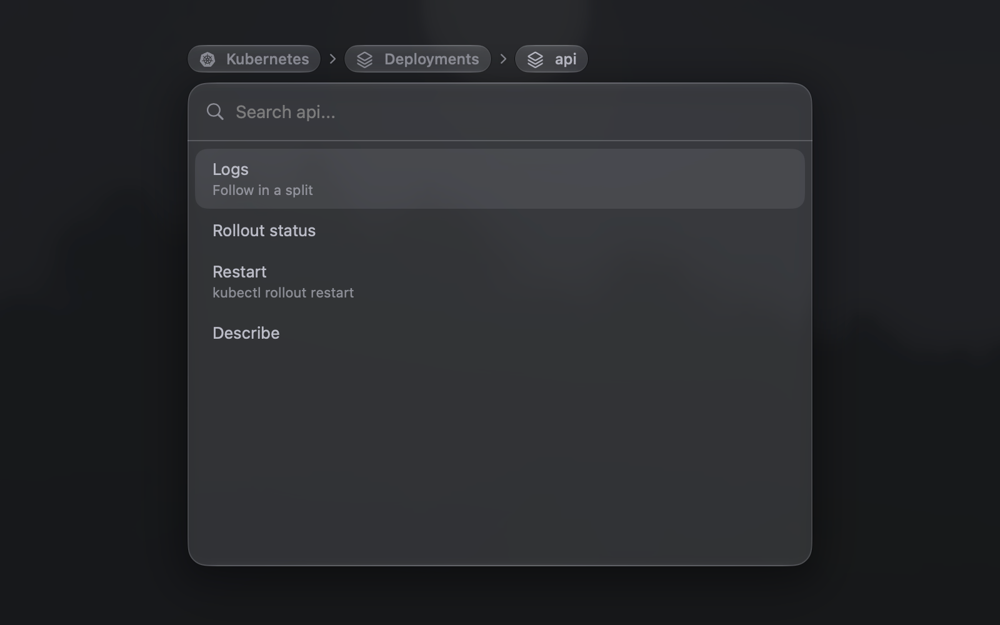
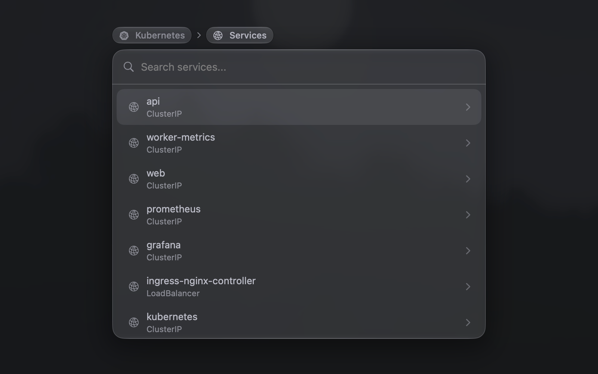

# Kubernetes

Browse a cluster from ⌘P: namespaces, pods, deployments and services. Each one has its own actions: follow logs, open a shell, watch a rollout and forward a port. You can also switch contexts.

While the cluster does not answer, every row except Contexts is muted and says *Cluster unreachable*.

Needs `kubectl`.

## Screenshots

### Kubernetes

### Namespaces

### Pods

### Deployments

### Deployment

### Services

